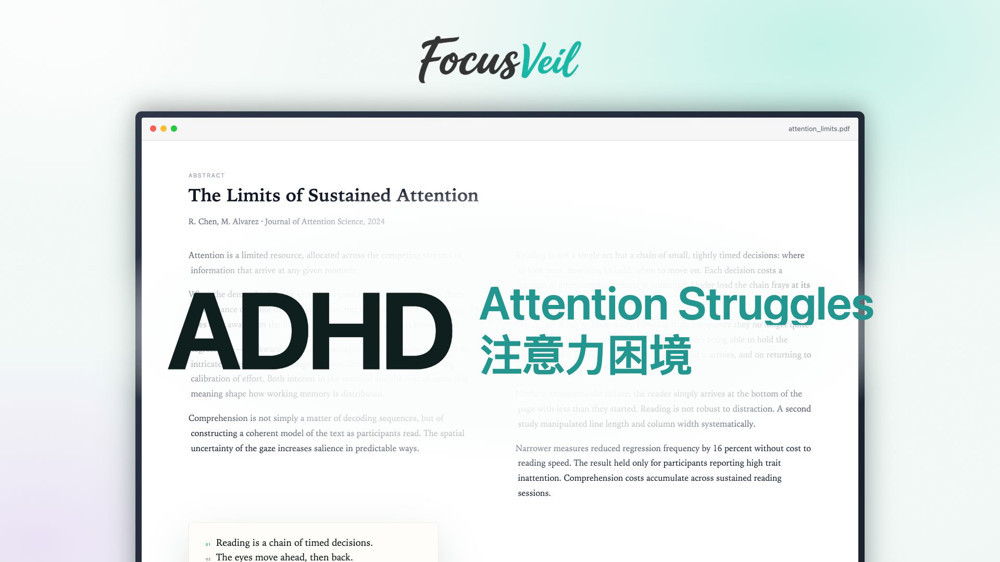
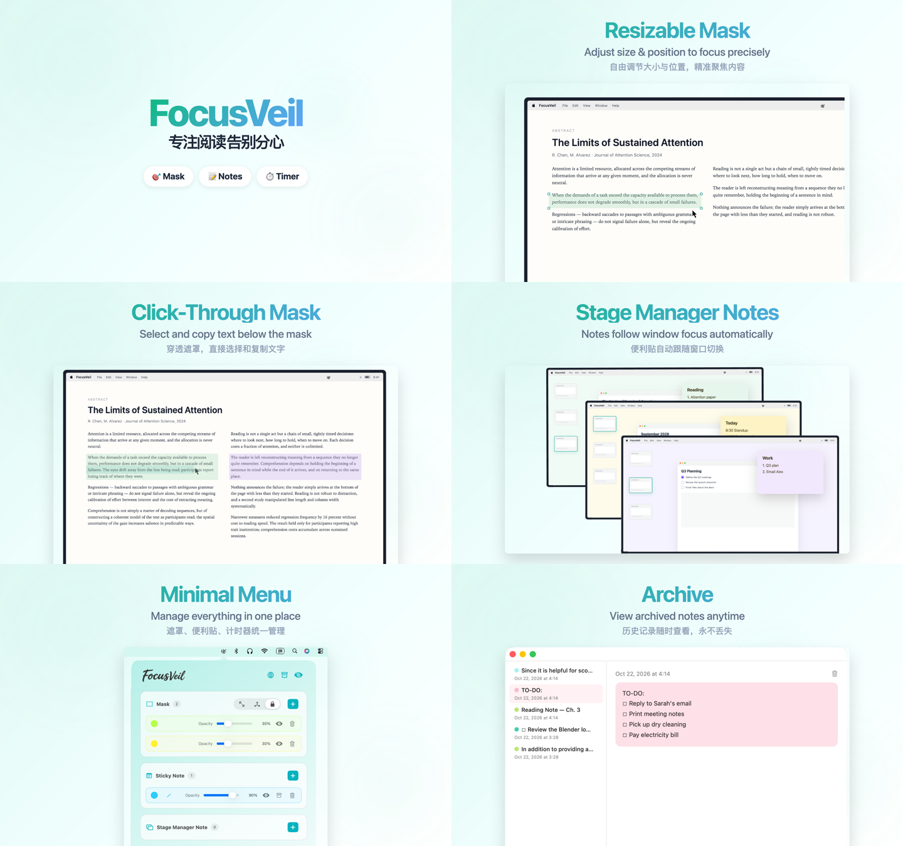

<div align="center">

# FocusVeil · Promo Video

**91 秒，1920×1080，30fps。用 Remotion 以代码讲一个「注意力辅助」产品的故事。**

[](https://www.remotion.dev/)
[](https://react.dev/)
[](https://www.typescriptlang.org/)
[]()



**如果这个项目帮你省了时间，点个 ⭐️ 就是最大的支持。**

</div>

---

## 这是什么

FocusVeil 是一款 macOS 上的注意力辅助工具：可移动或固定的遮罩帮你把注意力锁在正在读的那一段，全局和窗口便利贴帮你在切换任务时不丢事情。

**这个仓库是它的产品宣传片，不是 App 本体。** 整支片子没有用剪辑软件：每个镜头、每一条字幕、每一处卡点都是 React 组件加时间轴常量，`npm run dev` 就能在浏览器里逐帧调。

## 片子结构

| 时间 | 段落 | 画面 |
| --- | --- | --- |
| 0–10s | 开场 / Inattention | 论文、标题、ADHD 困境，推入 MacBook |
| 10–16.5s | 阅读跳行 | 正文逐行跳过，Copy-Through Overlay |
| 16.5–23.5s | 重复读行 | 同一行被复制、回读，`↻` |
| 23–30s | 多任务 | 三个 MacBook 窗口叠加，任务切换 |
| 30–37s | Give it a try | 中英 CTA + logo 收束 |
| 37–48s | 遮罩聚焦 / 鼠标穿透 | 绿紫遮罩、光标选中、Mask Focus |
| 48–55.5s | 移动模式 | 手柄缩放、颜色轮换、拖动 |
| 55.5–66.5s | 全局便利贴 | 菜单栏、置顶便利贴、切换桌面 |
| 66.5–73s | 窗口便利贴 | Stage Manager 三档，窗口左滑缩小切换 |
| 73–79s | 归档便利贴 | 归档窗口，历史记录 |
| 79–91s | App Store 搜索 | 搜索 FocusVeil、结果卡片、GET |

所有时间都写在 [`src/video/timeline.ts`](src/video/timeline.ts)，场景里不写死绝对秒数。

## 快速开始

```bash
npm install
npm run dev        # http://localhost:3000
npm run lint       # eslint + tsc
npx remotion render Hero out/focusveil.mp4
```

> 改片时建议只跑 Studio 预览；`npm run lint` 过了再导出，不要每改一版就渲染 MP4。

## 目录

```text
src/
  Root.tsx                 # composition 注册
  HeroScene.tsx            # 主时间轴，串起所有段落
  video/
    timeline.ts            # 唯一的 timing 源
    theme.ts               # 颜色、字体、背景光斑
    Cover.tsx / Paper.tsx / TitleCard.tsx / WobbleText.tsx
    MaskFocusScene.tsx     # 遮罩聚焦 + 鼠标穿透
    MaskResizeScene.tsx    # 移动模式 / 自由变换
    GlobalNoteScene.tsx    # 全局便利贴
    StageManagerScene.tsx  # 窗口便利贴（三档切换）
    ArchiveScene.tsx       # 归档便利贴
    AppStoreScene.tsx      # App Store 搜索结尾
    *Caption.tsx           # 双语字幕（白雾 + 擦除入场）
public/                    # 截图、图标、音频
docs/                      # App Store 文案、预览图
app-store-final copy.html  # 六张 App Store 截图源
```

## 设计规范

| 项 | 值 |
| --- | --- |
| 画幅 / 帧率 | 1920×1080 / 30fps |
| 背景 | `#F4FAF8` + 薄荷 / 淡紫光斑 |
| 主色 | teal `#38B6AE`，深 teal `#22968F` |
| 正文色 | ink `#0F1F1D`，body `#243430` |
| 字体 | SF Pro / PingFang SC；论文用 New York / Songti SC |
| 字幕 | 英文 68，中文 58；白色雾 + 从下往上擦除 |
| 便利贴 | 黄 `#FFF3C4` / 紫 `#F3E8FF` / 绿 `#E7F6EC` |
| 墙面 | 米黄 `#FFFBEB` / 淡紫 `#F6F3FF` / 淡绿 `#F1FBF4` |
| 音频 | 120 BPM，所有切点落在 0.5s 整数倍 |

## 提示词 & 工作流

这个项目是和 AI 一起逐帧改出来的。下面这些提示词模板和约定，比代码本身更省时间。

### 常用提示词范式

描述需求时按「对象 + 操作 + 约束」组织，比口语化的指令更容易一次到位。

- **新增场景 / 图层分离**：新增独立场景与对应字幕，把背景、窗口、遮罩、光标拆成独立图层与组件；时间写入 `timeline.ts`，沿用现有入场、配色与字幕规范。
- **调整时长 / 节奏**：缩短或延长指定段落的停留，后续段落整体平移；同步重算音频切点与总时长。
- **修改动画 / 转场**：调整入场、出场、转场的缓动、位移、缩放幅度与时长；保持图层层级、`transform-origin` 与视觉重心不变。
- **更新字幕 / 品牌元素**：替换标题或双语字幕，英文在前、中文在后；沿用白色雾、擦除入场与强调色。
- **替换素材 / 配色**：替换截图、图标、便利贴或墙面颜色；保持布局、比例与对比度，窗口内容不随配色变化。
- **导出与校验**：先在 Studio 逐帧预览，再跑 `npm run lint`；确认无闪烁、无空白帧后再 render。

### 约定

1. **时间只改 `timeline.ts`**。场景里用 `FPS` 和相对帧，不写绝对秒数。
2. **一个段落 = 一个 `*Scene` + 一个 `*Caption`**。字幕英文在前、中文在后。
3. **改完 timing 必须重算音频**。底音 `score-bed.mp3` 和切点 `score-cuts.mp3` 都是按切点生成的，切点 = 每段起点。
4. **Studio 里的 inline 改动优先保留**。例如 `MaskFocusScene` 光标 `translate`、`GlobalNoteScene` 面板 `scale/translate`、`LineSkipCaption` / `ReReadingCaption` 的 `-620px`，不要当脏代码清掉。
5. **每轮改完跑 `npm run lint`**，通过再提交；不要每轮导出 MP4。

## 音频

- `public/score-bed.mp3`：120 BPM 底音，91s，淡出结尾。
- `public/score-cuts.mp3`：每个段落切点的「叮」声，默认未挂载，需要时在 `HeroScene.tsx` 里加一条 `<Audio>`。
- 音乐是脚本合成的（pad + pluck + bass + kick/clap/hat），没有版权问题，可以随便换。

## App Store 文案

- [中文描述](docs/app-store-description-zh.txt) / [English description](docs/app-store-description-en.txt)
- [App Store 文案合集](docs/app-store-copy.md)
- 六张 2880×1800 截图：`out/app-store-screenshots/`（跑 `app-store-final copy.html` 导出）



## 致谢

- [Remotion](https://www.remotion.dev/) — 用 React 做视频
- [@remotion/mac-cursors](https://www.npmjs.com/package/@remotion/mac-cursors) — macOS 光标
- 字体与截图素材归 FocusVeil 所有

---

<div align="center">

**如果这个项目对你有帮助，点个 ⭐️，让更多人看到。**

</div>
